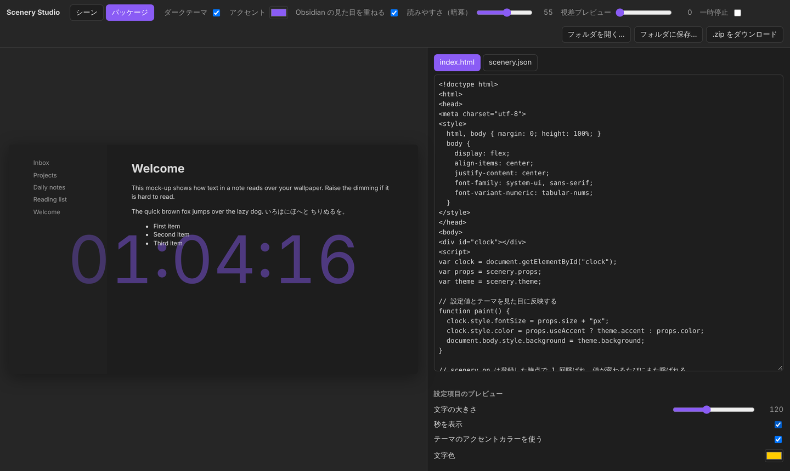
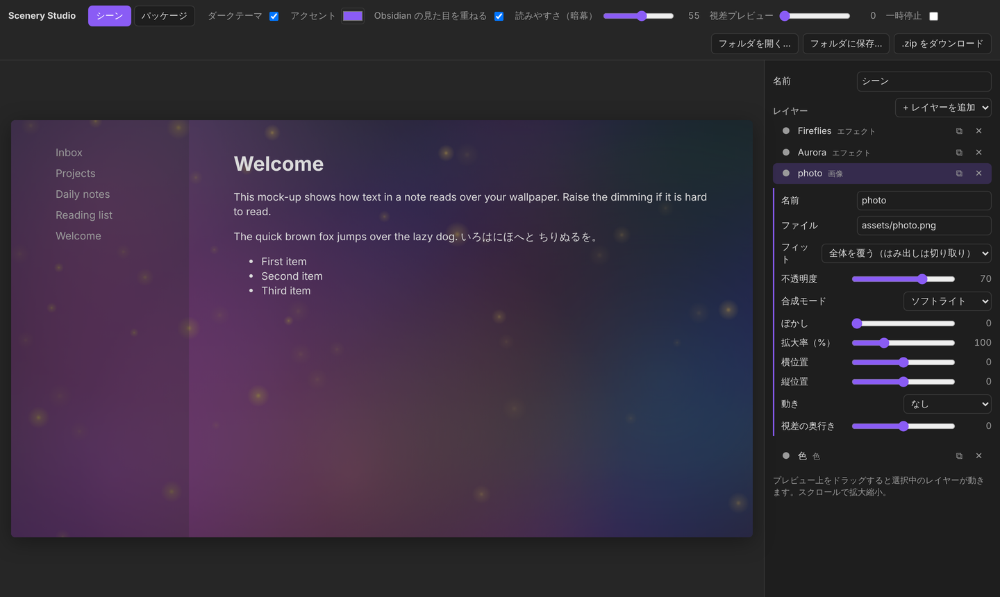

## はじめに

Obsidian のワークスペースの背後に、動く壁紙を表示するプラグイン「Scenery」を作りました。

https://github.com/chacha260/obsidian-scenery


できることは大きく 3 つです。

- **置く**:画像・動画・Web ページ・組み込みエフェクトを壁紙にする
- **重ねて作る**:画像や動画、エフェクトをレイヤーとして重ね、コードを書かずに壁紙を作る
- **書いて作る**:HTML と JavaScript で壁紙を書き、設定項目まで自分で用意する

きっかけは、PC のデスクトップで使っている Wallpaper Engine です。一日の大半は Obsidian を開いているので、同じように壁紙を動かせたら、と思ったのが出発点です。

開発には Anthropic の Claude Code を使いました。設計の相談から実装、テスト、コミュニティプラグインへの申請対応まで、対話しながら進めています。

## インストール

Obsidian 1.13.0 以降が必要です。デスクトップ版のみ対応しています。

**設定 → コミュニティプラグイン → 閲覧** で「Scenery」を検索し、インストールして有効化します。

有効にすると、まず Aurora エフェクトが壁紙として表示されます。

## 壁紙にできるもの

| 種類 | 内容 |
|:---|:---|
| 画像 | png、jpg、gif、webp、avif、svg など |
| 動画 | mp4、webm、mov など。ループ再生で、音量と再生速度を調整できます |
| Web ページ | 保管庫内の `.html`、または URL |
| エフェクト | Aurora、Starfield、Particles、Snow、Fireflies、Rain。テーマのアクセントカラーに追従します |
| シーン | 画像・動画・エフェクト・色を重ねて作る壁紙 |
| パッケージ | HTML と JavaScript で書く壁紙 |

## 基本の使い方


**設定 → Scenery** を開くと、壁紙の一覧(ライブラリ)があります。見出しの「＋」ボタンを押すと、メニューから追加方法を選べます。

- **Vault のファイル**:保管庫内の画像・動画・HTML を 1 つ追加
- **Vault のフォルダ**:フォルダ内の画像と動画をまとめて追加
- **URL / パス**:Web 上のファイルや、保管庫の外にあるファイルを追加

追加した壁紙は、行の「使う」ボタンで切り替わります。ファイル一覧で画像や動画を右クリックして「壁紙に設定」を選ぶこともできます。

ライブラリでは、次のことができます。

- **探す**:名前・パス・種類で検索できます。
- **並べ替える**:行をドラッグして順番を変えられます。
- **名前を変える**:鉛筆ボタンで、表示名を付け直せます。
- **取り消す**:削除は、直後の通知から元に戻せます。

### 文字が読みにくいとき

壁紙の上には、テーマの背景色が半透明で重なっています。濃くするほど文字が読みやすくなります。

**設定 → Scenery → 見た目** の「読みやすさ（暗幕）」で調整してください。同じページで、サイドバーの濃さ・ぼかし・明るさ・彩度・マウス視差も変えられます。

「この壁紙専用の見た目にする」をオンにすると、いま使っている壁紙だけに別の設定を持たせられます。明るい壁紙だけ暗幕を濃くする、といった使い分けができます。

### 自動で切り替える

**設定 → Scenery → 自動切り替え** に、2 つの方法があります。

- **スライドショー**:一定の間隔で、順番またはシャッフルで切り替えます。
- **テーマごとの壁紙**:ライトテーマ用とダークテーマ用を決めておくと、テーマの切り替えに合わせて壁紙も変わります。

### 負荷について

- **裏では止まる**:Obsidian のウィンドウがどれも前面にないあいだ、動画とエフェクトは止まります。
- **手動でも止められる**:コマンド「壁紙の一時停止/再開」で、いつでも止められます。
- **別ウィンドウにも出る**:ポップアウトしたウィンドウにも壁紙を表示します。設定でオフにできます。

## シーン:コードを書かずに壁紙を作る


コマンド「Scenery: シーンを作成」を実行すると、右サイドバーにシーンエディタが開きます。編集中のシーンがそのまま壁紙として表示されるので、実物を見ながら調整できます。

「レイヤーを追加」で、画像・動画・エフェクト・色(グラデーション)・パッケージを重ねていきます。レイヤーごとに、次の項目を設定できます。

- **重ね方**:不透明度、合成モード(スクリーン、乗算、オーバーレイなど)、ぼかし
- **置き方**:拡大率、位置、フィット
- **動き**:左右にゆれる、上下にゆれる、ただよう、ゆっくりズーム、回転、明滅
- **奥行き**:マウスに合わせて、レイヤーごとに動く量を変える

たとえば、夜景の写真の上に Fireflies をスクリーンで重ね、写真にゆっくりズームを付ける、といった壁紙が設定だけで作れます。

作ったシーンは、エディタの書き出しボタンで保管庫のフォルダに書き出せます。使っている画像や動画もフォルダの中にコピーされるので、フォルダごと人に渡せます。

## パッケージ:HTML と JavaScript で壁紙を書く

もっと自由に作りたい場合は、壁紙を Web ページとして書けます。保管庫内のフォルダに `scenery.json` と `index.html` を置いたものを「パッケージ」と呼んでいます。

コマンド「Scenery: 壁紙パッケージを作成」を実行すると、動くひな形が `Scenery/<名前>/` に作られます。ここでは、もっと小さい例として時計の壁紙を作ってみます。

### scenery.json

壁紙の名前と、使う人が変更できる設定項目を書きます。

```json
{
  "name": "Clock",
  "author": "you",
  "version": "1.0.0",
  "description": "テーマの色に合わせて表示される時計",
  "properties": {
    "size": { "type": "slider", "label": "文字の大きさ", "min": 40, "max": 240, "step": 10, "default": 120 },
    "seconds": { "type": "toggle", "label": "秒を表示", "default": true },
    "useAccent": { "type": "toggle", "label": "テーマのアクセントカラーを使う", "default": true },
    "color": { "type": "color", "label": "文字色", "default": "#ffffff" }
  }
}
```

`properties` に書いた項目は、Scenery の設定画面に自動で表示されます。使える種類は `slider`、`toggle`、`color`、`select`、`text` の 5 つです。

### index.html

```html
<!doctype html>
<html>
<head>
<meta charset="utf-8">
<style>
  html, body { margin: 0; height: 100%; }
  body {
    display: flex;
    align-items: center;
    justify-content: center;
    font-family: system-ui, sans-serif;
    font-variant-numeric: tabular-nums;
  }
</style>
</head>
<body>
<div id="clock"></div>
<script>
var clock = document.getElementById("clock");
var props = scenery.props;
var theme = scenery.theme;

// 設定値とテーマを見た目に反映する
function paint() {
  clock.style.fontSize = props.size + "px";
  clock.style.color = props.useAccent ? theme.accent : props.color;
  document.body.style.background = theme.background;
}

// scenery.on は登録した時点で 1 回呼ばれ、値が変わるたびにまた呼ばれる
scenery.on("props", function (p) { props = p; paint(); });
scenery.on("theme", function (t) { theme = t; paint(); });

function pad(n) { return String(n).padStart(2, "0"); }

function tick() {
  var d = new Date();
  clock.textContent = pad(d.getHours()) + ":" + pad(d.getMinutes()) + (props.seconds ? ":" + pad(d.getSeconds()) : "");
  // Obsidian が背面にある間、Scenery がこの呼び出しを止めてくれる
  requestAnimationFrame(tick);
}
requestAnimationFrame(tick);
</script>
</body>
</html>
```

この 2 つのファイルを保管庫の `Scenery/clock/` に置き、ライブラリの「＋ → Vault のフォルダ」で `Scenery/clock` を選ぶと、壁紙として表示されます。



上の画像は、次に紹介する Scenery Studio でこの時計を動かしているところです。右下に、`scenery.json` に書いた 4 つの設定項目が並んでいます。

### 壁紙から使える API

ページには `scenery` というオブジェクトが最初から用意されています。スクリプトを読み込む必要はありません。

`scenery.on(キー, 関数)` で値を受け取ります。関数は登録した時点で 1 回呼ばれ、以後は値が変わるたびに呼ばれます。

| キー | 受け取れる値 |
|:---|:---|
| `"props"` | `scenery.json` の `properties` に対応する設定値 |
| `"theme"` | ダーク/ライトの別と、アクセントカラー・背景色・文字色 |
| `"pointer"` | ウィンドウ内のポインタ位置(0〜1) |
| `"paused"` | 一時停止中かどうか |
| `"note"` | 開いているノートの名前とパス(使う人が許可した場合のみ) |

作るときに知っておくと良い点です。

- **保存すると読み直される**:パッケージ内のファイルを編集して保存すると、壁紙が自動で再読み込みされます。
- **裏では自動で止まる**:`requestAnimationFrame` で描画していれば、Obsidian が背面のあいだは何もしなくても止まります。
- **クリックは届かない**:壁紙はワークスペースの背後にあるため、クリックやキー入力は届きません。ポインタの位置だけは `"pointer"` で受け取れます。
- **隔離されている**:ページは隔離された枠の中で動き、保管庫のファイルや Obsidian 本体には触れられません。

詳しい仕様は、リポジトリの [docs/authoring.ja.md](https://github.com/chacha260/obsidian-scenery/blob/main/docs/authoring.ja.md) にまとめています。

## Scenery Studio:ブラウザで壁紙を作る

サイドバーの中だけでは作業しにくいので、壁紙を作るための Web アプリも用意しました。

https://chacha260.github.io/obsidian-scenery/



描画にはプラグインと同じコードを使っているので、ここで見たままが Obsidian に出ます。

- **シーンモード**:大きなプレビューに Obsidian の画面を模した表示を重ねて、読みやすさを確かめながら作れます。画像や動画はドロップで追加し、プレビュー上でレイヤーをドラッグして動かせます。
- **パッケージモード**:`index.html` と `scenery.json` を、動いているページの横で編集できます。宣言した設定項目もその場で試せます。
- **保存**:Chrome や Edge では、保管庫のフォルダへ直接保存できます。ほかのブラウザでは zip でダウンロードできます。

データはすべてブラウザの中で処理され、どこにも送信されません。

## Wallpaper Engine の壁紙を使う

Wallpaper Engine の壁紙のうち、種類が **Web** のものは、フォルダごと保管庫にコピーして「＋ → Vault のフォルダ」から追加できます。`project.json` に書かれた設定項目(スライダー、色、チェックボックスなど)も、設定画面に表示されます。

種類が **Video** のものは、フォルダの中の動画ファイル(mp4 など)をそのまま壁紙にできます。私も Workshop の動画をこの方法で使っています。

:::message alert
- Web 形式の読み込みは実験的です。公開されている仕様に沿って実装したもので、作品によっては動かないものがあります。
- 音に反応する壁紙は動きません。Scene 形式と Application 形式には対応していません。
- Workshop の作品は作者に権利があります。自分で使う範囲に留めてください。
:::

## 安全性について

:::message
- プラグイン自体は通信を行わず、利用状況の収集もしません。
- Web ページの壁紙とパッケージは HTML ページなので、その中のコードは通常の Web ページと同じくインターネットに接続できます。信頼できるものだけを追加してください。
- これらのページは隔離された枠(sandbox 付きの iframe)の中で動き、保管庫やノートの内容は読めません。
- 開いているノートの名前は、壁紙ごとに許可したときだけ渡します。初期状態ではオフです。
:::

## コマンド

コマンドパレットから操作できます。ホットキーは初期状態では割り当てていないので、**設定 → ホットキー** で好きなキーを設定してください。

| コマンド | 動作 |
|:---|:---|
| 壁紙のオン/オフ | 壁紙の表示を切り替える |
| 次の壁紙 / 前の壁紙 / ランダムな壁紙 | ライブラリの中で切り替える |
| 壁紙を選ぶ | 一覧から選んで切り替える |
| 壁紙の一時停止/再開 | 動画とエフェクトを止める・再開する |
| 壁紙を再読み込み | いまの壁紙を読み直す |
| シーンを作成 / シーンを編集 | シーンエディタを開く |
| シーンをフォルダに書き出す | 使用中のシーンを保管庫に書き出す |
| 壁紙パッケージを作成 | ひな形のパッケージを作る |

表示言語は Obsidian の設定に従い、日本語と英語に対応しています。

## 制限

- デスクトップ版のみ対応です。
- 音声に反応する壁紙は作れません。
- デフォルトテーマと Minimal で動作を確認しています。独自の背景色を強く指定するテーマでは、一部のパネルが透けないことがあります。
- 重い動画とぼかしを組み合わせると、GPU の負荷が上がります。

## おわりに

壁紙を置くだけでも、レイヤーを重ねて作り込むことも、コードで書くこともできるようにしました。毎日開く画面を少し自分好みにしたい方は、試してみてください。

不具合や要望は、GitHub の Issue でお知らせください。

https://github.com/chacha260/obsidian-scenery
